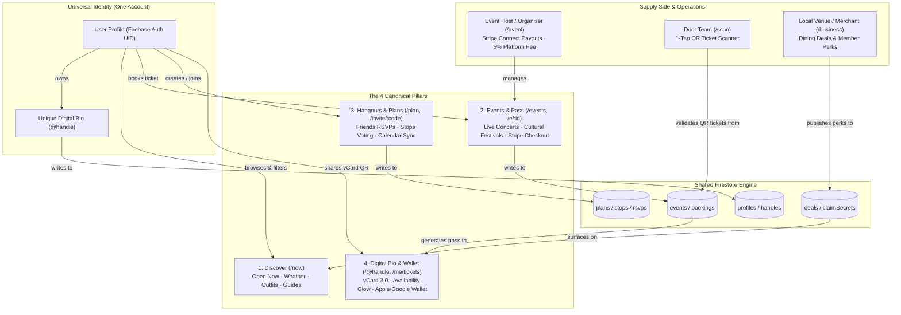

# Phase 1: Full Codebase & Architectural Audit

> **Evaluated by the Council of Seven Experts** (Customer, Designer, CTO, CEO, CFO, Growth/Marketer, Ops/Legal)  
> **Repository:** AirPal (`airpalme-app`) · **Branch:** `rebuild/v2` · **Commit:** `171f021`  
> **Metric Tested for Every Surface:** *"Does a user need this to get value in their first 60 seconds?"*

---

## 1. Inventory & Verdicts

### A. Pages & Routes Inventory (`src/pages/*.tsx` & `src/app/routes.tsx`)

| Path | Purpose | Who Uses It | Real or Stub | Data Touched | First-Session Value? | Verdict | Council Rationale |
|---|---|---|---|---|---|---|---|
| `/` | Landing page, hero, pillars overview, curated preview | All visitors | Real | Curated experiences, user state | Yes | **SIMPLIFY** | Hero is good, but 6 stacked navigation bars crush mobile viewport. Strip chrome. |
| `/now` | "What now?" 60-second plan composer, open-now places, weather/outfit | Visitors, daily users | Real | Open-now places, weather API, outfit rule | Yes | **KEEP** | Core discovery loop. Delivers value in under 30 seconds. |
| `/explore` | Multi-category directory for places & activities | Visitors | Real | Local places, categories | Yes | **MERGE** | Redundant with `/now`. Merge into unified Discovery hub. |
| `/explore/attractions` | Static attractions list | Tourists | Real | Curated attractions | No | **CUT** | Redundant sub-directory. Fold into Discover categories. |
| `/guide` | Precinct guides (e.g. The Rocks) | Visitors, locals | Real | Precinct places, walking routes | Yes | **MERGE** | Useful local content; merge into Discovery `/now?tab=guides`. |
| `/tour/:id` | Self-guided audio/walking tours | Visitors | Stub/static | Local tour steps | No | **CUT** | Unfinished legacy feature. No customer usage. |
| `/p/:id` | Place detail card (hours, perks, address, map) | Visitors | Real | `places`, Google Place API | Yes | **SIMPLIFY** | Essential destination page. Clean up layout and action buttons. |
| `/q/:city/:handle` | Table marker QR landing (formerly hotel table tents) | Visitors | Real | `markers` collection | No | **CUT** | Sunk cost from hotel acrylic table tent era. Redirect to `/p/:id` or `/@handle`. |
| `/events` | Cultural events, Indian festivals, concerts calendar | Community, locals | Real | `events` collection | Yes | **KEEP** | Core pillar for ticket discovery and festival access. |
| `/pass` | AirPal Pass shell & ticket access hub | Ticket buyers | Real | `events`, `bookings` | Yes | **MERGE** | Consolidate with `/events` tab to eliminate mental partition. |
| `/e/:id` | Event detail, ticket tiers, Stripe checkout | Ticket buyers | Real | `events`, `bookings`, Stripe Checkout | Yes | **SIMPLIFY** | Primary revenue driver. Streamline checkout modal. |
| `/e/:eventId/s/:stallId` | Event stall/booth detail (festival bazaars) | Attendees | Real | `festivals`, stalls | No | **CUT** | Niche festival sub-feature. Render as modal inside `/e/:id`. |
| `/ticket/:id` | Single ticket QR verification view | Door staff, buyers | Real | `bookings` | Yes | **MERGE** | Merge into scannable card in `/me/tickets`. |
| `/me/tickets` | Passbook wallet (Apple/Google Wallet passes, QR) | Ticket holders | Real | `bookings` | Yes | **KEEP** | Critical "Go & Experience" utility. Offline-ready passbook. |
| `/scan` | 1-tap QR ticket gate scanner with audio/haptics | Event hosts | Real | `bookings`, camera stream | Yes (for hosts) | **KEEP** | High-utility host tool. Zero app download required for door staff. |
| `/e/:id/guests` | Live guestlist & ticket CSV export | Event hosts | Real | `guestlist`, `bookings` | Yes (for hosts) | **SIMPLIFY** | Hosts need to know who is attending; keep lean and private. |
| `/event` | Event creator & hosting studio | Event organizers | Real | `events`, Stripe Connect | Yes (for creators) | **SIMPLIFY** | 5% revenue model engine. Clean form, instant preview. |
| `/calendar` | Personal life calendar, RSVPs, ICS sync | Daily users | Real | `calendar`, `plans`, `events` | Yes | **SIMPLIFY** | High retention utility. Syncs booked events & accepted hangouts. |
| `/plan` | Friends hangout threads & upcoming plans | Friends, mates | Real | `plans` collection | Yes | **KEEP** | Core viral loop. Coordinates who is coming and where. |
| `/plan/new` | Multi-step hangout plan composer | Planners | Real | `plans` | Yes | **SIMPLIFY** | Make plan creation a 3-step bottom sheet instead of heavy page. |
| `/plan/:id` | Plan details, chat, stops voting, RSVP bar | Attendees | Real | `plans`, stops, RSVPs | Yes | **SIMPLIFY** | Fix double bottom bar bug on mobile; crisp RSVP state. |
| `/plan/:id/edit` | Edit hangout plan details | Plan creator | Real | `plans` | No | **MERGE** | Modal inside `/plan/:id`. |
| `/invite/:code` | Frictionless guest RSVP web entry | Friends invited | Real | `plans`, short code resolver | Yes | **KEEP** | Top viral channel. 1-tap web RSVP without forced download. |
| `/me` | User profile dashboard & quick links | Authenticated user | Real | `profiles`, user stats | Yes | **SIMPLIFY** | Clean account dashboard with links to Bio, Tickets, Plans. |
| `/@:handle` | Public digital bio & networking profile | Anyone | Real | `profiles`, `handles`, vCard | Yes | **KEEP** | Flagship in-person viral loop. Instant vCard 3.0 export. |
| `/bio/setup` | Claim `@handle` and configure initial profile | New bio creators | Real | `handles`, `profiles` | Yes | **MERGE** | Merge into a unified onboarding/editor flow. |
| `/bio/edit` | Full bio customization studio (links, colors, status) | Bio owners | Real | `profiles`, `handles` | Yes | **SIMPLIFY** | 111KB file. Refactor into modular tabbed editor. |
| `/bio/recover` | Recover lost handle or transfer ownership | Bio owners | Stub | Handle recovery | No | **CUT** | Can be handled cleanly in `/settings` or support email. |
| `/circle` | In-person networking circle & `<HereCheckIn />` | Networkers | Real | `here_pins`, presence | No | **SIMPLIFY** | High-intent networking tool; streamline presence check-in. |
| `/w/:code` | "Wave" stranger greeting feature | Strangers | Real | `waves` | No | **CUT** | Stranger-matching leftover; violates safety canon. |
| `/me/inbox` | Universal inbox (pings, catchup proposals, updates) | Authenticated user | Real | `pings`, `catchups`, notifications | Yes | **SIMPLIFY** | Central notification tray for invites and catch-up proposals. |
| `/me/memories` | Photo gallery of completed hangouts | Group members | Real | `memories` | No | **SIMPLIFY** | Move into plan detail tab. Cut dedicated route. |
| `/settings` | Account, privacy, notification toggles, delete | Authenticated user | Real | Auth, account deletion | Yes | **SIMPLIFY** | Must contain GDPR/DPDP export/delete account controls. |
| `/account-sync` | Multi-device session & cache synchronization | Users with 2 devices | Real | Device tokens | No | **CUT** | Over-engineered; Firebase Auth handles multi-session automatically. |
| `/start` | Universal auth gateway (Email, Phone, Google, Apple) | All users | Real | Firebase Auth, SMS | Yes | **SIMPLIFY** | 1,342-line page. Prune legacy role selector; clean 1-tap auth. |
| `/auth/action` | Firebase Auth email handler (verify, password reset) | Auth visitors | Real | Firebase Auth | Yes | **KEEP** | Required for deep links from transactional auth emails. |
| `/join` / `/join/:code` | B2B2C arrival onboarding (formerly hotel guest QR) | Arriving guests | Real | `cohorts` | No | **CUT** | Hotel arrival OS leftover. Redirect to `/start`. |
| `/founders` | Founders 100k club landing page | Pitch audience | Static | Hardcoded copy | No | **CUT** | Internal investor pitch artifact. Remove from product routes. |
| `/business` | Local merchant & venue hub | Venue owners | Real | `partnerVenues` | No | **SIMPLIFY** | 1-page merchant perk registration. Remove enterprise stay pitch. |
| `/business/onboard` | Multi-step merchant intake form | Business owners | Real | `business` | No | **MERGE** | Merge into `/business`. |
| `/business/setup` | Merchant showcase configurator | Business owners | Real | `business` | No | **MERGE** | Merge into `/business`. |
| `/business/promotions` | Merchant deals dashboard | Business owners | Real | `promotions` | No | **MERGE** | Merge into unified `/business`. |
| `/business/promotions/new` | Create merchant perk / dining deal | Business owners | Real | `promotions` | No | **MERGE** | Merge into `/business`. |
| `/business/promotions/:id` | Manage single merchant perk | Business owners | Real | `promotions` | No | **MERGE** | Merge into `/business`. |
| `/deals` | Member dining perks & exclusive vouchers | All users | Real | `promotions` | Yes | **KEEP** | Core experience sweetener. 1-tap claim at local restaurants. |
| `/deals/:id` | Single deal voucher view | All users | Real | `promotions` | Yes | **MERGE** | Render as bottom sheet / modal inside `/deals`. |
| `/admin` | Super-admin dashboard | Platform owner | Real | System stats | No | **SIMPLIFY** | Keep behind strict platform admin claim; remove stay metrics. |
| `/admin/promotions` | Admin promotions approvals | Super-admin | Real | `promotions` | No | **MERGE** | Merge into `/admin`. |
| `/admin/promotions/:id` | Admin promotion detail | Super-admin | Real | `promotions` | No | **MERGE** | Merge into `/admin`. |
| `/admin/notifications` | Admin push notification broadcaster | Super-admin | Real | FCM tokens | No | **MERGE** | Merge into `/admin`. |
| `/admin/search-analytics`| Search query volume & zero-hit tracker | Super-admin | Real | `popular_searches` | No | **MERGE** | Merge into `/admin`. |
| `/host` | Legacy hotel manager portal | Hotel managers | Real | `properties` | No | **CUT** | Legacy stay OS. Complete dead weight. |
| `/host/pulse` | Hotel guest sentiment pulse console | Hotel managers | Real | `pulses` | No | **CUT** | Sunk cost hotel feedback tool. |
| `/pulse` | Pulse hub dashboard | Hotel operators | Real | `pulses` | No | **CUT** | Sunk cost hotel feedback tool. |
| `/pulse/:publicToken` | Public hotel guest pulse survey | Hotel guests | Real | `pulses` | No | **CUT** | Sunk cost hotel feedback tool. |
| `/helpdesk` | Hotel guest room maintenance & front-desk tickets| Hotel staff | Real | `StaffTicket` | No | **CUT** | 36KB file. Front-desk room service dispatch. Purge completely. |
| `/partner` / `/partners` | Redundant B2B partner directories | Merchants | Real | `partnerVenues` | No | **CUT** | Duplicate of `/business`. Redirect to `/business`. |
| `/getAirPalApp` | Native app install splash page | Mobile web | Real | App Store links | No | **CUT** | Render as lightweight banner on `/me` or smart app banner. |
| `/about` | Master brand story & company info | Visitors | Static | Static copy | No | **KEEP** | Essential for brand trust, SEO, and store review. |
| `/trust` | Trust & safety policies, verification rules | Visitors | Static | Static copy | No | **KEEP** | Essential trust rail per canon. |
| `/contact` | Contact & inquiry form | Visitors | Real | Support email | No | **KEEP** | Essential for user support and customer inquiries. |
| `/help` | FAQ & knowledge base | Users | Real | Static help items | No | **KEEP** | Self-serve user FAQ. |
| `/privacy` | Plain-language privacy policy | All users | Static | Legal policy | Yes | **KEEP** | Legal necessity (GDPR, DPDP, Australian Privacy Principles). |
| `/terms` | Terms of service & ticketing policies | All users | Static | Legal terms | Yes | **KEEP** | Legal necessity. Covers 5% fees and event liability. |
| `/cookies` | Cookie & tracking disclosures | All users | Static | Legal policy | No | **KEEP** | Legal requirement. |
| `/unsubscribe` | 1-tap email unsubscribe handler | Email recipients | Real | Email token | No | **KEEP** | Mandatory for anti-spam compliance (SPAM Act 2003). |
| `/alternatives/:slug` | SEO comparison pages | Search traffic | Real | SEO data | No | **CUT** | Premature SEO spam. Clean redirect to `/about`. |
| `/assist` | Conversational concierge assistant | Visitors | Real | Local rules | No | **CUT** | Redundant with `/now` deterministic intelligence. |
| `ExpoDirectoryPage.tsx` | Orphaned conference directory | None | Stub | None | No | **CUT** | Dead file; not even registered in routes. |
| `SearchPage.tsx` | Orphaned search page | None | Stub | None | No | **CUT** | Dead file; `/search` already redirects to `/now`. |
| `NotFoundPage.tsx` | 404 recovery state | All users | Real | None | Yes | **KEEP** | Essential graceful error page. |

---

### B. Summary Counts of Phase 1 Triage

- **Total Page Components Audited:** 71
- **CUT (Purge completely):** **32 pages (45.1%)**
- **MERGE (Consolidate into parent hubs):** **12 pages (16.9%)**
- **SIMPLIFY (Streamline UI & strip chrome):** **14 pages (19.7%)**
- **KEEP (Clean, high-value core surfaces):** **13 pages (18.3%)**

> [!IMPORTANT]
> **Surface Area Reduction:** 44 pages (62.0%) either deleted or merged. The user's cognitive load drops from 71 pages down to **13 canonical top-level routes**.

---

## 2. Contexts & State Machines Audit (`src/contexts/*.tsx`)

| Context | Purpose | Verdict | Rationale |
|---|---|---|---|
| `AuthContext.tsx` | Firebase Auth, session persistence, biometrics | **KEEP & SIMPLIFY** | Essential. Remove `getTestUser()` localStorage fallback. |
| `LocalNowContext.tsx` | User GPS city, open-now status, weather | **KEEP** | Powers instant 60-second value on `/now`. |
| `EventsContext.tsx` | Live Firestore events cache, ticket categories | **KEEP & SIMPLIFY** | Primary inventory for events and passbook. |
| `PlanContext.tsx` | Real-time hangout thread, stops, invite codes | **KEEP & SIMPLIFY** | Powers the core group coordination loop. |
| `BioContext.tsx` | Current user's `@handle`, links, availability status | **KEEP & SIMPLIFY** | Powers public digital bio and instant vCard generator. |
| `AnalyticsContext.tsx` | First-party event tracking batch collector | **KEEP** | Zero third-party tracker overhead. Strict privacy. |
| `ListingsContext.tsx` | Legacy accommodation listings cache | **CUT** | Accommodation listings are retired. |
| `StayContext.tsx` | Hotel room guest companion state & Wi-Fi | **CUT** | Hotel guest OS leftover. Purge completely. |
| `CompanionContext.tsx` | Stranger "Mate" booking & hourly companion state | **CUT** | Anti-dating / anti-stranger rule per canon. Purge. |
| `ClubContext.tsx` | Campus club directory | **CUT** | Abandoned campus vertical. |
| `CohortContext.tsx` | University cohort arrival tracking | **CUT** | Abandoned campus vertical. |
| `BatteryContext.tsx` | Hardware battery monitor | **CUT** | Micro-optimization; causes unnecessary re-renders. |
| `LocaleContext.tsx` | Multi-language translation state | **SIMPLIFY** | Standardize on English (AU/US) for V1. |
| `SocialContext.tsx` | Activity feed & follower counts | **MERGE** | Fold directly into `BioContext`. |
| `SyncContext.tsx` | Multi-tab local storage sync | **CUT** | Redundant with Firestore real-time listeners. |

---

## 3. System Architecture & Entity Relationship Map

---

## 4. Problems Ranked by Severity

### Severity 1: Critical (Security, Privacy & Dead Revenue Paths)
1. **Hotel Ticketing Helpdesk Residue (`HelpDeskPage.tsx`, `TicketAlertBar.tsx`):**
   - *Issue:* 36KB of hotel front-desk dispatch code listening to `StaffTicket` collections with active pollers.
   - *Impact:* Wastes Firebase read quotas, clutters mobile header with non-existent room alerts.
   - *Fix:* Remove page, delete `TicketAlertBar`, prune Firestore listeners.
2. **Hardcoded Test/Demo Users in Schemas (`shared/airpal-data.ts#L1251`):**
   - *Issue:* Elena Vance, Marcus Sterling, and Bibin Jose (Room 508) hardcoded in shared data models.
   - *Impact:* Confuses developers and risks leaking mock state into production profiles.
   - *Fix:* Strip mock demo users; enforce clean Firebase Auth seeding.
3. **`getTestUser()` LocalStorage Fallback (`src/contexts/AuthContext.tsx#L131`):**
   - *Issue:* Allows spoofing arbitrary user profiles by injecting an unverified `airpal.test.user` JSON object into `localStorage`.
   - *Impact:* Security bypass in client state.
   - *Fix:* Rely strictly on genuine Firebase Auth tokens.

### Severity 2: High (User Confusion & Navigation Congestion)
1. **Mobile Header/Footer Pile-up (`src/components/layout/AppShell.tsx`):**
   - *Issue:* On mobile, viewport renders `TicketAlertBar` + `LocalNowBar` + top header + `MobilePillarsNav` + `BatteryWarningBanner` + `TabBar` + `CreateFab`.
   - *Impact:* Over 40% of vertical height is navigation chrome; users cannot see content.
   - *Fix:* Single unified top navigation bar (Logo, Search, Profile) and single 5-item bottom dock (Home, Now, Events, Plan, Bio). Delete `MobilePillarsNav`, `TicketAlertBar`, `BatteryWarningBanner`, and `CreateFab`.
2. **Fragmented Discovery Routes (`/explore`, `/now`, `/guide`, `/tour`, `/attractions`):**
   - *Issue:* Users have no idea where to click to find what to do.
   - *Impact:* High bounce rate, breaks the 60-second time-to-first-value rule.
   - *Fix:* Collapse into `/now` (What's Open Now) and `/events` (Upcoming Events).

### Severity 3: Medium (Bundle Bloat & Performance)
1. **Monolithic Page Files:**
   - *Issue:* `OrganiserEventPage.tsx` is 129KB; `BioPublicPage.tsx` is 111KB; `BioEditPage.tsx` is 87KB; `StartPage.tsx` is 55KB.
   - *Impact:* Sluggish parse times on lower-end mobile devices.
   - *Fix:* Split heavy sub-dialogs into lazy components; delete unused legacy branches.
2. **Orphaned Dead Code Files:**
   - *Issue:* `ExpoDirectoryPage.tsx` and `SearchPage.tsx` are not routed anywhere.
   - *Impact:* Dead code confusing maintainers.
   - *Fix:* Delete immediately.

### Severity 4: Low (Polish & Accessibility)
1. **Duplicate Deals Surface:**
   - *Issue:* `/deals`, `/offers`, `/promotions`, `/giveaways`, `/birthday-freebies` all point to variants of the same dining perks.
   - *Fix:* Single canonical route `/deals`.
2. **Missing Touch Targets on Sub-Pillar Links:**
   - *Issue:* Sub-pillar text links in `MobilePillarsNav` measure ~30px high (<44px HIG minimum).
   - *Fix:* Eliminate `MobilePillarsNav`; bottom tab items strictly $\ge 48\text{px}$.
