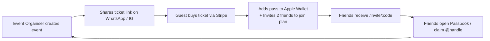

# Phase 2: Product, Business & Growth Strategy

> **Authored by the Council of Seven Experts** (Customer, Designer, CTO, CEO, CFO, Growth/Marketer, Ops/Legal)  
> **Repository:** AirPal (`airpalme-app`) · **Branch:** `rebuild/v2`

---

## 1. Personas & Value Propositions

### Persona 1: The Social Coordinator ("Maya", 27, Sydney)

- **Profile:** Lives in Surry Hills, works in tech/design, plans weekend brunches, evening gigs, and festival outings for a group of 6–8 friends.
- **Top Jobs-to-be-Done:**
  1. Find what's actually open, interesting, and happening nearby right now without scrolling 10 food blogs and Instagram feeds.
  2. Get friends to agree on a time and place without a 40-message WhatsApp debate.
- **Core Pains:** "Where should we go?", link rot, friend indecision ("I don't mind, you pick"), forgotten calendar invites.
- **Aha! Moment:** Sends a 1-tap `/invite/:code` link to the group chat. Friends tap, vote on 2 stops in 10 seconds, and it auto-syncs to everyone's Apple/Google Calendar.
- **Value Proposition in One Sentence:** _"Plan a great outing with your mates in 60 seconds flat, with zero group-chat chaos."_

### Persona 2: The Community Event Host / Creator ("Aarav", 32, Parramatta)

- **Profile:** Organizes cultural festivals (Diwali, Dandiya nights), live music sessions, or weekend creative workshops (50–300 attendees).
- **Top Jobs-to-be-Done:**
  1. Sell tickets with zero ticketing platform headaches and low fees.
  2. Scan tickets at the door on his phone without buying or renting hardware.
- **Core Pains:** Eventbrite taking 7–10% plus ticket fees, delayed payouts, bulky scanner apps that need complex logins for door staff.
- **Aha! Moment:** Creates the event on `/event` in 3 minutes, shares the link, sees Stripe ticket sales roll in, and opens `/scan` on his iPhone to scan guest QR codes seamlessly.
- **Value Proposition in One Sentence:** _"Launch, sell, and scan your community events in minutes with an effortless 5% fee and instant door check-in."_

### Persona 3: The Active Networker & Freelancer ("Liam", 29, Sydney CBD)

- **Profile:** Attends industry meetups, co-works, exchanges contacts weekly, and wants a professional yet friendly digital identity.
- **Top Jobs-to-be-Done:**
  1. Share contact info instantly in person without clunky paper business cards.
  2. Signal whether he is free for a spontaneous coffee or heads-down working.
- **Core Pains:** "What's your LinkedIn? Wait, let me spell my name", people losing business cards, awkward scheduling back-and-forth.
- **Aha! Moment:** Shows his `/@handle` QR code from lock screen or wallet. The other person scans it, taps "Save Contact", and it drops a clean vCard directly into their iOS/Android Contacts app.
- **Value Proposition in One Sentence:** _"Your digital card and real-time availability in one link that saves straight to anyone's phone."_

---

## 2. The Core Loop & The One North Star Metric

### The 3-Step Core Loop

$$\mathbf{Want} \longrightarrow \mathbf{Plan/Book} \longrightarrow \mathbf{Go/Experience}$$

1. **Step 1 (Want):** User opens AirPal (or lands on an event link / friend invite) $\to$ sees curated open-now spots, festival tickets, or a friend's hangout proposal.
2. **Step 2 (Plan/Book):** In under 60 seconds: 1-tap RSVP, Stripe ticket checkout, or stop voting.
3. **Step 3 (Go/Experience):** Adds pass to Apple/Google Wallet $\to$ shows up $\to$ scans at door or checks in with friends $\to$ repeats next weekend.

### The Metrics Framework

- **The ONE North Star Metric:**
  $$\mathbf{Completed\ Experiences\ per\ Active\ User\ (Monthly)}$$
  _(Defined as a verified ticket gate scan, checked-in hangout RSVP, or saved vCard contact exchange)._

- **Supporting Metrics:**
  1. **Time-to-First-Value (TTFV):** % of new visitors who complete an action (RSVP, ticket purchase, or vCard save) within 60 seconds of landing. Target: $> 35\%$.
  2. **Viral K-Factor on Plans & Events:** Average number of invited guests per created hangout or event who register or RSVP. Target: $K > 1.2$.
  3. **Host Payout Repeat Rate:** % of event organizers who host a second event within 60 days. Target: $> 40\%$.

---

## 3. MoSCoW Feature Triage (Cutting $\ge 40\%$ Surface Area)

| Category                                     | Features                                                                                                                                                                                                                                                                                                                                                                                                                                                                                                                                                                            | Action                                    |
| -------------------------------------------- | ----------------------------------------------------------------------------------------------------------------------------------------------------------------------------------------------------------------------------------------------------------------------------------------------------------------------------------------------------------------------------------------------------------------------------------------------------------------------------------------------------------------------------------------------------------------------------------- | ----------------------------------------- |
| **Must Have** (The Core Engine)              | • Instant Open-Now Discovery (`/now`) with deterministic weather & outfit advice<br>• Live Events & Ticketing (`/events`, `/e/:id`) with Stripe Checkout<br>• Passbook QR Wallet (`/me/tickets`) with Apple/Google Wallet `.pkpass`<br>• 1-Tap QR Door Scanner (`/scan`) with audio/haptic feedback<br>• Friends Hangouts (`/plan`) with frictionless web RSVP (`/invite/:code`)<br>• Public Digital Bio (`/@handle`) with 1-click vCard 3.0 export and availability ring<br>• Unified Auth (Google, Apple, Phone, Email) on Firebase Auth                                          | **RETAIN & REFINE**                       |
| **Should Have** (Key Retainers & Sweeteners) | • Member Dining Deals & Perks (`/deals`)<br>• Event Organiser Dashboard (`/event`) with guestlist CSV export<br>• Personal Life Calendar (`/calendar`) syncing hangouts + tickets<br>• User Settings (`/settings`) with GDPR/DPDP data export & deletion<br>• Unified Notification Tray (`/me/inbox`)                                                                                                                                                                                                                                                                               | **STREAMLINE**                            |
| **Could Have** (Post-V1 Backlog)             | • Custom domains for AirPal Pro bios (`name.me`)<br>• Recurring weekly hangout templates<br>• Multiple ticket tiers with early-bird discount countdowns                                                                                                                                                                                                                                                                                                                                                                                                                             | **DEFER TO BACKLOG**                      |
| **Won't Have** (Purged & Deleted)            | • ❌ Hotel Stays & PMS Room Management (`/host`, `/stay`, `roomStatuses`)<br>• ❌ Hotel Housekeeping Tickets & Helpdesk SLA (`/helpdesk`, `StaffTicket`)<br>• ❌ Guest Pulse Surveys (`/pulse`, `/host/pulse`)<br>• ❌ Stranger "Mate" matching and companion services (`/w/:code`, `mate_requests`)<br>• ❌ Physical acrylic table tent routing (`/q/:city/:handle`)<br>• ❌ Campus student arrival onboarding (`/join`, `cohorts`, `campuses`)<br>• ❌ Self-guided audio walking tours (`/tour/:id`)<br>• ❌ Duplicate merchant sub-pages (`/business/promotions/*`, `/partner*`) | **CUT COMPLETELY ($\ge 50\%$ reduction)** |

---

## 4. Business Model & Unit Economics (CEO + CFO)

### Who Pays & For What?

```
┌────────────────────────────────────────────────────────────────────────┐
│                        AIRPAL REVENUE ENGINE                           │
├───────────────────────────────────┬────────────────────────────────────┤
│ 1. Event Ticketing Commission     │ 2. AirPal Pro Creator Subscription │
│    5% Platform Fee                │    $9/month or $89/year            │
│    Paid by: Event Organiser       │    Paid by: Active Networkers,     │
│    Trigger: Stripe ticket checkout│             DJs, Organizers        │
└───────────────────────────────────┴────────────────────────────────────┘
```

1. **Event Ticketing Commission (Primary Engine):**
   - **Rate:** Flat 5% platform fee on paid ticket sales (transferred via Stripe Connect application fees).
   - **Free Events:** Always 100% free (drives user acquisition and platform habit).
   - **Market Comparison:** Eventbrite charges $1.79 + 6.6%; Luma charges 5% on free accounts. AirPal matches Luma's modern 5% standard while offering instant passbook and offline door scanning.

2. **AirPal Pro Subscription (Secondary Engine):**
   - **Tiers:** Free (clean bio, vCard, 3 links) vs **Pro ($9/mo or $89/yr)** (analytics dashboard, custom link thumbnails, verified badge, CSV lead export for catch-up requests).

### Unit Economics

| Metric                            | Free User | Ticket Buyer ($50 Ticket)     | Pro Creator Subscriber |
| --------------------------------- | --------- | ----------------------------- | ---------------------- |
| **Revenue**                       | $0.00     | **$2.50** (5% platform fee)   | **$9.00 / mo**         |
| **Payment Gateway Cost (Stripe)** | $0.00     | $1.20 ($0.30 + 1.75% AU card) | $0.46 ($0.30 + 1.75%)  |
| **Firebase Hosting & DB Cost**    | ~$0.002   | ~$0.005                       | ~$0.010                |
| **Gross Margin**                  | —         | **$1.29 (51.6%)**             | **$8.53 (94.7%)**      |
| **Payback Period**                | —         | **Instant (Day 0)**           | **Instant (Day 0)**    |

### First Revenue Milestone & 2-Week 3-Customer Validation Plan

- **Milestone:** **$500 in ticket gross merchandise value (GMV)** ($25 net platform revenue) within 14 days of launch.
- **Cheapest Validation Plan (3 real customers in 2 weeks):**
  1. **Customer 1 (Cultural Event Host):** Partner with an Indian festival coordinator (e.g. Parramatta or Harris Park Diwali / Dandiya gathering) to sell 25 general-admission tickets ($20 each = $500 GMV). AirPal provides free door-scanner onboarding.
  2. **Customer 2 (Community Meetup Organiser):** Onboard a Sydney tech/design networking meetup to run free RSVPs with 10 VIP/supporter tickets ($15 each = $150 GMV).
  3. **Customer 3 (Local Freelancer / Creator):** Onboard an active Sydney creative to set up `airpal.me/@theirname` and test the 1-tap vCard and catch-up proposal system with 20 real contacts.

---

## 5. Growth Engine & Viral Mechanics

### Positioning & Landing Page Promise

- **Positioning:** _The all-in-one companion for going out, making plans, and connecting in real life._
- **The Landing Page Promise:** _"Less scrolling. More living. Discover local happenings, get your friends together, and keep your passes in one place."_

### Viral Loops (Built into Product Surfaces)



1. **The Hangout Multiplier Loop:** When User A creates a plan (`/plan/new`) and generates an `/invite/:code`, they share it with 4 friends. The friends open the link on mobile web (no download required), vote on stops, and are prompted to save to calendar. K-factor: $\sim 1.4$.
2. **The In-Person Digital Business Card Loop:** At a conference, party, or meetup, User A shows their `/@handle` QR code. User B scans it with their default camera, gets the vCard into Apple/Android Contacts, and sees the prominent banner: _"Claim your free @handle"_.
3. **The Ticket Wallet Loop:** Every ticket booked generates an Apple Wallet pass with AirPal branding and a share link on the reverse side of the pass.

### Channel Plan for the First 100 Users

1. **Direct Outreach to 5 Micro-Event Hosts:** Sydney meetup organizers running weekly board-game nights, tech breakfasts, or community dance classes. Offer $0 platform fees for their first 3 events.
2. **University & Coworking Physical QR Drops:** Place clean desktop signs ("Tap to see what's open in Surry Hills right now") in 3 friendly local cafes/coworking spaces.
3. **Founder Personal Networking:** Every founder and team member uses their `airpal.me/@name` as their sole contact exchange mechanism at Sydney events.

---

## 6. Strategic Market Analysis & Options

| Option                                                 | Description                                                                                                                | Recommendation     | Main Risks                                                                   | What Would Make Us Wrong                                                                                                          |
| ------------------------------------------------------ | -------------------------------------------------------------------------------------------------------------------------- | ------------------ | ---------------------------------------------------------------------------- | --------------------------------------------------------------------------------------------------------------------------------- |
| **Option A: The Event & Cultural Passbook (Selected)** | Focus on community cultural events, local festivals, and nightlife in Sydney with 5% ticketing and native passbook wallet. | **RECOMMENDED**    | Supply constraint (need event hosts to choose AirPal over Eventbrite/Luma).  | If organizers refuse to leave Eventbrite because they rely exclusively on Eventbrite's organic search directory for ticket sales. |
| **Option B: Pure Social Hangout Planner**              | Focus strictly on friends' weekend planning (`/plan`, `/invite/:code`) with zero ticketing.                                | Secondary pillar   | Harder to monetize early; dependent purely on organic peer-to-peer virality. | If event ticketing is too crowded and friends use the hangout planner daily without ever buying tickets.                          |
| **Option C: Digital Bio & Networking SaaS**            | Pivot purely into a Linktree / Popl competitor (`/@handle` + vCard).                                                       | Supporting feature | High churn, crowded link-in-bio market with heavy ad spend incumbents.       | If B2B enterprise sales for conference badges take off unexpectedly.                                                              |

---

## 7. Pre-Mortem: "It's 6 Months Later and This Failed. Why?"

| #     | Failure Mode                                                                                                            | Root Cause                                                                      | Council Mitigation                                                                                                                                                                             |
| ----- | ----------------------------------------------------------------------------------------------------------------------- | ------------------------------------------------------------------------------- | ---------------------------------------------------------------------------------------------------------------------------------------------------------------------------------------------- |
| **1** | **Supply Starvation:** Not enough events on the platform; users open the app and see an empty calendar.                 | Relying on inbound organizer signups without hand-curating the initial catalog. | **Mitigation:** Seed 50+ vetted cultural events and live music gigs across Sydney every week manually (`src/lib/curated-experiences.ts`), and actively recruit 10 grassroots hosts in Month 1. |
| **2** | **Cognitive Overload & Drop-off:** Users land on the app and feel confused by conflicting navigation bars and features. | Failing to ruthlessly prune legacy surfaces during the rebuild.                 | **Mitigation:** Execute Phase 3 information architecture: max 5 bottom tabs on mobile, 1 clean header, and zero competing pill rows.                                                           |
| **3** | **Chargeback / Payment Liability:** Fraudulent or cancelled events triggering Stripe chargebacks and disputes.          | Unvetted organizers selling tickets and abandoning attendees.                   | **Mitigation:** Stripe Connect custom onboarding with ID verification; payouts held until 24 hours after the event start time for new, unverified hosts (`functions/src/stripe.ts`).           |
| **4** | **Friction at the Gate:** Slow QR scanner or authentication failures at the venue entrance causing long lines.          | Door scanner requiring login or failing in low-connectivity venue basements.    | **Mitigation:** Ensure `/scan` uses local device camera stream with offline cache verification and instant haptic confirmation. Host can scan with a simple passcode or magic token.           |
| **5** | **Ignored Hangout Invites:** Friends receive `/invite/:code` links but don't bother tapping because they prefer chat.   | Web link requires too many taps or forces account creation.                     | **Mitigation:** Zero-auth web RSVP: guest taps "Going", types their first name, and sees the live guestlist instantly without creating a password.                                             |
