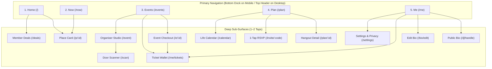

# Phase 3: UX & Information Architecture Specification

> **Authored by the Council of Seven Experts** (Customer, Designer, CTO, CEO, CFO, Growth/Marketer, Ops/Legal)  
> **Repository:** AirPal (`airpalme-app`) · **Branch:** `rebuild/v2`

---

## 1. The Clean Sitemap & Navigation Architecture

Every page on the platform is reachable in **2 taps or fewer** from the primary navigation shell.



### Nav Rules & Touch Ergonomics:

1. **Zero Stacked Headers:** Purge `MobilePillarsNav`, `TicketAlertBar`, and `LocalNowBar` from the fixed top stack. The mobile top header is strictly **36px–44px** with: `[Brand Logo]` on the left, and `[Search Icon]` + `[Profile Avatar]` on the right.
2. **Bottom Dock (Mobile):** 5 buttons with $\ge 48\text{px}$ touch targets, elevated with Liquid Glass backdrop blur and `shadow-clay`.
3. **Deep Links & Shareable URLs:**
   - Public bios: `airpal.me/@alex`
   - Hangout invites: `airpal.me/invite/xyz89`
   - Event tickets: `airpal.me/e/spark-fest-2026`
   - Ticket passes: `airpal.me/ticket/t-1234`
4. **No Dead Ends:** Every sub-page includes an accessible sticky back-button (`ArrowLeft` with tactile haptic trigger) that returns to the canonical parent tab.

---

## 2. Core User & Host Flows

### Flow A: 60-Second Onboarding to First Value (New Visitor)

1. **0–15s:** Maya opens `airpal.me` on Safari $\to$ immediate editorial hero shows "Sydney · Open Now" without forced login.
2. **15–30s:** Taps **Now** $\to$ sees weather ($21^\circ\text{C}$, clear) and deterministic outfit ("Light denim or knitwear") + 3 open cafes nearby.
3. **30–45s:** Taps "Plan a Hangout" $\to$ selects "Surry Hills Coffee" $\to$ sets time: Saturday 10:30 AM.
4. **45–60s:** Taps "Create Link" $\to$ native OS share sheet opens with `airpal.me/invite/wknd-coffee`. **First value delivered in under 60 seconds.**

### Flow B: Frictionless Guest RSVP Flow (No App Required)

1. Friend Liam receives WhatsApp message with `airpal.me/invite/wknd-coffee`.
2. Liam taps link $\to$ opens lightweight web view.
3. Sees: "Maya's Coffee Hangout · Single O Surry Hills · Sat 10:30 AM".
4. Taps **"I'm In ✓"** $\to$ enters name ("Liam") $\to$ one tap to "Add to Apple Calendar".
5. Status changes to "Going". No password, no app install required.

### Flow C: Event Discovery, Stripe Ticket & Passbook Flow

1. Aarav visits `/events` $\to$ taps "Diwali Lights & Music Night".
2. Taps "Get Ticket" ($25) $\to$ enters email + card/Apple Pay via Stripe Checkout.
3. Payment succeeds $\to$ instant confirmation dialog with **"Add to Apple Wallet"** (`.pkpass`) button and scannable QR pass in `/me/tickets`.
4. Event automatically populates his personal AirPal Calendar (`/calendar`).

### Flow D: Host Gate Scanner Flow (`/scan`)

1. Door host Marcus opens `/scan` on his iPhone.
2. Requests camera permission once $\to$ points camera at arriving guest's phone QR.
3. Instant haptic tick (`medium`) + green flash: **"Valid Ticket · Aarav Patel · Tier 1 General Admission"**.
4. If scanned a second time: red warning flash + audio reject buzzer: **"Already Checked In at 19:42"**.

### Flow E: Empty, Error & Offline States

- **Empty States:** Clean illustration, positive tone, and single prominent CTA button (e.g. Empty tickets page shows _"No passes yet. Explore what's on this weekend"_ with link to `/events`).
- **Offline State:** Service Worker serves cached passes from `/me/tickets` so users are never stranded outside a venue with no mobile signal.
- **Error State:** Friendly recovery banner with "Try Again" and "Back to Home", logging the error quietly to `error_reports`.

---

## 3. Design System & Tokens (Apple Liquid Glass + Soft Clay)

### Color Tokens

```css
:root {
  /* Brand Core */
  --color-brand: #1805db; /* AirPal Blue */
  --color-brand-ink: #0f038a; /* Deep Royal Blue */
  --color-brand-tint: rgba(24, 5, 219, 0.08);

  /* Surface & Canvas */
  --color-paper: #faf9f5; /* Warm editorial parchment */
  --color-card: #ffffff; /* Clean card surface */
  --color-line: rgba(0, 0, 0, 0.08); /* Hairline border */

  /* Typography */
  --color-ink: #121614; /* High-contrast body text */
  --color-mute: #6b7280; /* Secondary metadata text */

  /* Accents & Status */
  --color-accent: #1805db;
  --color-success: #10b981; /* Emerald (Available / Valid Pass) */
  --color-warning: #f59e0b; /* Amber (Be Right Back / Low Tickets) */
  --color-danger: #ef4444; /* Rose (Busy / Already Scanned) */
}
```

### Spacing & Typography Scale

- **Display Headings:** `font-display tracking-tight font-extrabold`
  - Hero: `text-3xl sm:text-5xl` (32px / 48px)
  - Section Title: `text-xl sm:text-2xl` (20px / 24px)
  - Card Title: `text-base sm:text-lg` (16px / 18px)
- **Body & Inputs:**
  - Body: `text-sm sm:text-base` (14px / 16px)
  - Meta/Sub-labels: `text-xs` (12px)
  - Micro-badges: `text-[10px] font-bold uppercase tracking-wider`
  - **Form Input Hygiene:** Minimum `16px` font size on mobile to prevent iOS Safari auto-zoom.
- **Elevation & Materials:**
  - **Apple Liquid Glass:** `backdrop-blur-xl bg-card/90 ring-1 ring-line/80`
  - **Soft Clay Shadows:** `shadow-[0_8px_24px_-4px_rgba(0,0,0,0.06),0_2px_6px_rgba(0,0,0,0.04)]`

---

## 4. Wireframe Specifications for Retained Pages

### 1. Home Page (`/`)

- **Purpose:** Fast orientation and entry to the 3 core actions.
- **Primary Actions:** "Find what's open now" (`/now`), "Plan a hangout" (`/plan/new`), "Browse events" (`/events`).
- **Data Shown:** Editorial greeting, open-now recommendations strip, upcoming cultural event cards, member perk banner.
- **Removed & Why:** Removed 4-pillar category buttons, `TicketAlertBar`, `LocalNowBar`, and floating FAB to restore vertical clarity.

### 2. "Now" Discovery Page (`/now`)

- **Purpose:** Instant 60-second answer to "What should I do right now?".
- **Primary Actions:** Filter by urge (Coffee, Dine, Night, Culture, Chill), toggle map/list view.
- **Data Shown:** Real-time Sydney weather + deterministic outfit recommendation (`src/lib/outfit.ts`), live open-now status with closing times, distance in meters.
- **Removed & Why:** Removed hotel room stay cards and generic attractions directories.

### 3. Events & Pass Page (`/events`)

- **Purpose:** Primary discovery and booking surface for gigs, festivals, and community gatherings.
- **Primary Actions:** Filter by category (Festivals, Music, Social, Workshops), tap event card to open `/e/:id`.
- **Data Shown:** Event title, date, venue location, ticket price range (or "Free"), organizer avatar, availability badge.
- **Removed & Why:** Consolidated separate `/pass` and `/events` tabs into one unified surface.

### 4. Event Detail & Checkout (`/e/:id`)

- **Purpose:** Clear event briefing and secure Stripe ticket checkout.
- **Primary Actions:** "Get Tickets" button triggering Stripe Checkout sheet.
- **Data Shown:** Hero cover, start/end time, venue address with map link, ticket tier pricing, organizer bio link, refund policy.
- **Removed & Why:** Removed stall directory sub-pages (`/e/:id/s/:stallId`).

### 5. Friends Hangout Hub & Invites (`/plan`)

- **Purpose:** Organizing social outings with friends.
- **Primary Actions:** "New Hangout" (`/plan/new`), view active plans, copy invite link.
- **Data Shown:** Upcoming hangouts, attendee avatars with RSVP status ("Going", "Maybe"), voting tally for stops.
- **Removed & Why:** Removed stranger mate requests (`mate_requests`) and duplicate trip archives.

### 6. Public Digital Bio (`/@handle`)

- **Purpose:** In-person networking business card and contact exchange.
- **Primary Actions:** "Save Contact" (1-tap vCard 3.0 export), "Propose Catch-Up" (coffee/meeting modal), "Share QR".
- **Data Shown:** Avatar with live availability status ring (🟢 Available, 🔴 Busy), name, title, bio, 1-tap WhatsApp/Call buttons, custom external links tree.
- **Removed & Why:** Removed hotel booking buttons and complex e-commerce catalog rows.
